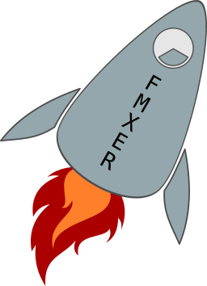

# FMXER
Declarative visual framework for FMX.
Inspired by Google Flutter's approach.

## Documentation
**[andrea-magni.github.io/FMXER](https://andrea-magni.github.io/FMXER/)**: guide, element catalog, reference and demos ([llms.txt](https://andrea-magni.github.io/FMXER/llms.txt) for AI assistants).

## AI agent skill
The [`Skills/`](Skills/) folder has an [Agent Skill](https://andrea-magni.github.io/FMXER/guide/agent-skills) for Claude Code and other AI coding agents. Install it as a plugin: `/plugin marketplace add andrea-magni/FMXER`, then `/plugin install fmxer@fmxer`.

## Installation
The setup (see the releases), TMS Smart Setup (`tmsbuild.yaml`), the runtime packages in `packages\` or the `source\` folder in the search path: see [Installation](https://andrea-magni.github.io/FMXER/guide/installation).

## Delphi version:
 - Delphi 12 Athens and 13 Florence (Skia built into RAD Studio). Delphi 11 is supported up to FMXER v.1.1.

## Submodules:
 - lib\TFrameStand: [TFrameStand and TFormStand](https://github.com/andrea-magni/TFrameStand)
 - lib\DelphiZXingQRCode: [DelphiZXingQRCode](https://github.com/foxitsoftware/DelphiZXingQRCode)
  
## Demos
 - HelloWorld
 - DataSet
 - Column
 - MarginAndPadding
 - Skia101
 - LibraryStore
 - WebView

## Video
 - [CodeRage 2019: Introducing FMXER](https://youtu.be/RiK2re19Kyk)

## Dependencies
1. [TFrameStand and TFormStand](https://github.com/andrea-magni/TFrameStand)
2. Skia (built into Delphi 12 and later)
3. [IconFontImageList](https://github.com/EtheaDev/IconFontsImageList)
4. [DelphiZXingQRCode](https://github.com/foxitsoftware/DelphiZXingQRCode)

## Available Forms/Frames
[List of available elements](List.md)
Missing something? just open an issue or implement your own (it's easy!) and submit a pull request.

Contact me if you encounter any problem (just open an issue here) and please provide me some feedback about this project!

# Related Links
Embarcadero Delphi is a modern, powerful and effective language and development tool. Learn more about it at the following links:
 * https://www.embarcadero.com/
 * https://learndelphi.org/
